<h1 align="center">Proxy Scanner</h1>

<p align="center">
  <b>Набор инструментов сетевой диагностики для специалистов</b><br>
  прокси · трассировка · узлы · DNS · HTTP · сервисы · TLS · домен AD · аудит · трафик · мониторинг
</p>

<p align="center">
  Windows 10/11 и Linux · один файл без установки · работает без интернета · окно и командная строка
</p>

<p align="center">
  <a href="https://github.com/Svarshik-arch/Proxy-Scanner/releases/latest/download/proxy-scanner-windows-x64.zip"><b>⬇ Скачать для Windows</b></a>
  &nbsp;·&nbsp;
  <a href="https://github.com/Svarshik-arch/Proxy-Scanner/releases/latest/download/proxy-scanner-linux-x64.tar.gz"><b>⬇ Скачать для Linux</b></a>
  &nbsp;·&nbsp;
  <a href="https://github.com/Svarshik-arch/Proxy-Scanner/releases/latest">все файлы и контрольные суммы</a>
</p>

<p align="center">
  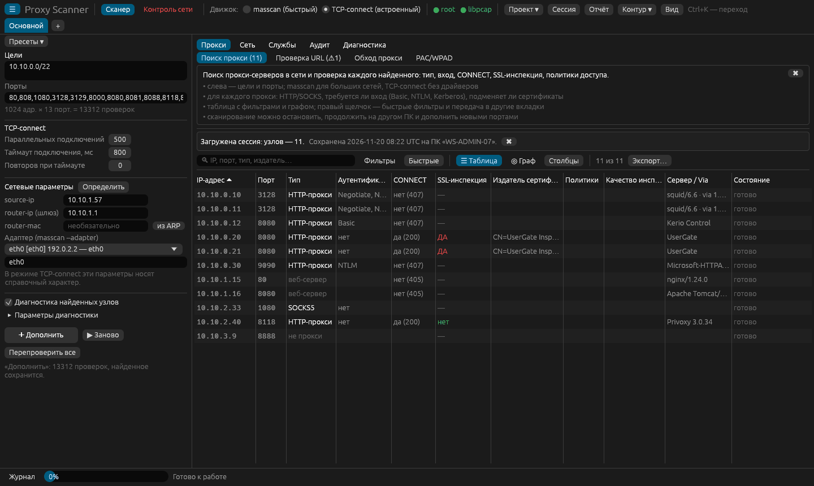
</p>

<p align="center">
  <a href="#что-умеет">Что умеет</a> ·
  <a href="#быстрый-старт">Быстрый старт</a> ·
  <a href="#прокси">Прокси</a> ·
  <a href="#сеть">Сеть</a> ·
  <a href="#службы">Службы</a> ·
  <a href="#аудит">Аудит</a> ·
  <a href="#диагностика">Диагностика</a> ·
  <a href="#контроль-сети">Контроль сети</a> ·
  <a href="#общие-возможности">Общие возможности</a> ·
  <a href="#командная-строка">Командная строка</a>
</p>

---

## Зачем

В одной программе — то, для чего обычно открывают десяток утилит: `ping` и `tracert`/MTR,
`nslookup`/`dig`, `curl`, сканер сервисов, testssl, проверку домена, Wireshark для быстрого
взгляда на трафик. С понятными итогами («что не так и что сделать»), общими сессиями, отчётом
и пресетами.

Программа рассчитана на **закрытый контур**: корневые сертификаты и DNS берутся из системы,
база производителей сетевых карт вшита в программу, во внешний мир она не обращается, пока
вы сами этого не попросите.

## Что умеет

Два режима работы — переключатель в шапке:

* **Сканер** — разовые проверки: прокси, сеть, службы, аудит, «почему не открывается сайт».
* **Контроль сети** — постоянный контроль: обзор на одном экране, наблюдение за изменениями
  по расписанию, мониторинг, угрозы в сегменте, живая карта, сценарии.

Проекты открываются **вкладками, как в браузере**: у каждого объекта или филиала свои цели и
результаты, переключение — одним щелчком.

| Раздел | Вкладка | Для чего |
|---|---|---|
| **[Прокси](#прокси)** | Поиск прокси | находит HTTP/SOCKS-прокси и проверяет каждый: вход (Basic, NTLM, Kerberos), CONNECT, SSL-инспекция, политики |
| | Проверка URL | список адресов через каждый прокси: пропущен, заблокирован, подменён сертификат |
| | Обход прокси | можно ли выйти наружу мимо прокси: TCP, внешние DNS, HTTP/HTTPS |
| | PAC/WPAD | системные настройки прокси, поиск WPAD, вычисление PAC-файла |
| **[Сеть](#сеть)** | Хост | интерфейсы, маршруты, ARP, соединения с процессами |
| | MTR | трассировка с наблюдением: потери и задержка по хопам, поиск MTU |
| | Узлы | кто есть в подсети: имена, производитель по MAC, догадка об ОС |
| | Доступность | правила межсетевого экрана «узел:порт open/closed», слушатель на второй машине |
| | Трафик | захват пакетов: коммутатор и порт (LLDP/CDP), DHCP-серверы, подмена ARP, **кто занимает канал**, pcapng |
| | Карта | схема сети из собранных данных |
| **[Службы](#службы)** | DNS | как `dig`: любые записи и серверы, DoT/DoH, сравнение серверов, AXFR |
| | HTTP | как `curl -v`: время по фазам, через прокси с NTLM/Kerberos, сертификаты |
| | Сервисы | баннеры и версии: SSH, HTTP, TLS, SMB, RDP, СУБД, NTP, SNMP… |
| | TLS | версии SSL 3.0 – TLS 1.3, шифры (включая ГОСТ), цепочка, оценка A–F |
| | Домен AD | почему не входит в домен: контроллеры, Kerberos, LDAP, сдвиг часов, SMB |
| | Общие ресурсы | SMB-шары и NFS-экспорты, доступ без пароля |
| | Коммутаторы | SNMP: какой MAC за каким портом и в каком VLAN; «где воткнут?» для любого узла |
| | Адреса | учёт адресов: занятость подсетей, свободные диапазоны, давно не отвечавшие, расхождения DNS, конфликты |
| **[Аудит](#аудит)** | Аудит настроек | SMBv1, Telnet, RDP без NLA, SNMP public, Redis без пароля… с рекомендациями |
| | Сертификаты | все найденные сертификаты по сроку окончания, выгрузка в Excel |
| | Сравнение сессий | что изменилось с прошлой проверки |
| **[Диагностика](#диагностика)** | Почему не открывается | DNS → TCP → TLS → HTTP → прокси/PAC за одну проверку; вывод, что мешает |
| | Сценарии | несколько проверок подряд одной кнопкой; по расписанию — с отчётом «что изменилось» на почту |
| **[Контроль сети](#контроль-сети)** | Обзор | тревоги, сбои, угрозы, сертификаты — одним экраном |
| | Наблюдение | новые и пропавшие узлы, смена MAC, порты, сертификаты — по расписанию, с уведомлениями |
| | Мониторинг | ping, порты, сайты, DNS, сертификаты по расписанию; почта и syslog; работа как служба |
| | Угрозы | посторонний DHCP, подмена ARP, mitm6 (IPv6 RA), Responder (LLMNR/NBT-NS), смена корня STP |
| | Карта | живая карта: связи по трафику, сбои мониторинга, изменения, порты коммутаторов |

И ещё: **карточка узла** (всё об адресе на одной странице, заметки и метки), **известные
уязвимости** по версиям сервисов (встроенная база CVE, без интернета), **калькулятор подсетей прямо в Ctrl+K** (наберите `10.0.0.0/22 /24`), **Wake-on-LAN** и
**«Где воткнут?»** в меню любого узла, [отчёт HTML](#отчёт) одной кнопкой, [проекты](#проекты-и-сессии) для разных объектов,
[пресеты](#пресеты-открытый-и-закрытый-контур) для каждого инструмента, **Ctrl+K** — быстрый
переход, правый щелчок по узлу — передать его в другой инструмент. В начале каждой вкладки —
короткое описание её возможностей.

<sub>На скриншотах — демонстрационные данные (условная сеть 10.10.0.0/22, домен corp.local).</sub>

## Быстрый старт

| Система | Архив |
|---|---|
| Windows 10/11 x64 | [**proxy-scanner-windows-x64.zip**](https://github.com/Svarshik-arch/Proxy-Scanner/releases/latest/download/proxy-scanner-windows-x64.zip) |
| Linux x64 | [**proxy-scanner-linux-x64.tar.gz**](https://github.com/Svarshik-arch/Proxy-Scanner/releases/latest/download/proxy-scanner-linux-x64.tar.gz) |

Ссылки всегда ведут на последнюю сборку; контрольные суммы — на странице
[релиза](https://github.com/Svarshik-arch/Proxy-Scanner/releases/latest). В архиве: программа
с окном, программа для командной строки, masscan, скрипт запуска и описание инструментов.
Те же файлы по отдельности — в папке [`release`](release).

### Windows 10/11

1. Скачайте и распакуйте архив для Windows.
2. Запустите `proxy-scanner.cmd`: скрипт запросит права администратора, снимет блокировку
   SmartScreen, проверит Npcap (и установит его, если рядом лежит `npcap-*.exe`) и откроет
   программу. `proxy-scanner.cmd -User` — без прав администратора.
3. Можно запускать и сам `proxy-scanner.exe`: большинство инструментов работает без прав
   администратора и без драйверов.

### Linux

Нужна glibc 2.35 или новее (Ubuntu 22.04+, Debian 12+, RHEL/Alma/Rocky 10, Astra Linux 1.8+) и
графический сеанс X11 или Wayland.

```bash
tar xzf proxy-scanner-linux-x64.tar.gz && cd proxy-scanner
```

```bash
./proxy-scanner.sh
```

Скрипт поднимает лимит открытых файлов, ставит libpcap при необходимости, разрешает root
открыть окно на вашем экране, запускает программу через `sudo` и после выхода отзывает доступ.
`./proxy-scanner.sh --caps` — интерфейс без root, права получает только masscan.

### Что нужно для каких функций

| Что нужно | Для чего |
|---|---|
| ничего | DNS, HTTP, TLS, сервисы, узлы, домен AD, аудит, мониторинг, доступность, поиск прокси через TCP-connect, ping и трассировка в Windows |
| права администратора / root | захват трафика, masscan, ICMP в Linux, установка мониторинга службой |
| Npcap (Windows) / libpcap (Linux) | захват трафика и masscan (подгружаются во время работы, без них программа запускается) |

Монитор гаснет при движении мыши по окну (NVIDIA и мониторы с FreeSync / G-SYNC Compatible) —
программа сама создаёт для себя профиль в драйвере NVIDIA без адаптивной частоты (при первом
запуске может спросить права администратора). Повторить — **«Вид → Графика → Выключить G-SYNC
для программы»**; там же выбор вывода: DirectX 12 или OpenGL.

---

## Прокси

### Поиск прокси


* **Поиск открытых портов** двумя способами: `masscan` (сотни тысяч пакетов в секунду, нужны
  Npcap/libpcap и права администратора) или встроенный **TCP-connect** (без драйверов и прав,
  сети до /16).
* **Автоопределение сети**: source-ip, шлюз, адаптер для masscan, MAC шлюза — при старте и по
  кнопке «Определить».
* **Проверка каждого найденного узла**: HTTP-прокси / SOCKS5 / SOCKS4 / веб-сервер / не прокси;
  схемы входа (`Proxy-Authenticate`), заголовки `Server` и `Via`, поддержка `CONNECT`.
* **Вход на прокси**: NTLM и Kerberos (Negotiate) под текущим пользователем Windows без пароля
  (как браузер), с учётной записью (NTLMv2 и в Linux), Basic. Видно, кем и как выполнен вход.
* **SSL-инспекция**: сертификат, полученный через прокси, сравнивается с эталоном (прямое
  подключение или заданный отпечаток SHA-256). **Качество инспекции**: через прокси
  открываются сайты с плохими сертификатами — если прокси переподписывает их своим CA,
  пользователь не увидит ошибку, и это помечается как проблема.
* **Политики доступа**: список URL с ожиданием (`+ URL` — разрешено, `- URL` — запрещено).
* **Таблица** с сортировкой, панелью подробностей, экспортом в CSV (Excel) и JSON;
  **фильтры** по типу, входу, CONNECT, SSL-инспекции, политикам, портам, подсетям, времени
  отклика; быстрые наборы («прокси без входа», «открытый CONNECT», «с SSL-инспекцией»…).
* **Граф** в духе Obsidian: подсети → узлы → сервисы → издатели сертификатов, силовая
  раскладка, линза «рыбий глаз» (клавиша F).
* **Продолжение и дополнение**: сканирование можно остановить и продолжить, в том числе на
  другом ПК (файл сессии переносится вместе с программой), а после завершения — добавить
  порты или подсети: уже проверенное повторно не сканируется.
* **Повторы** при таймаутах и обрывах: загруженный прокси часто не отвечает с первого раза.

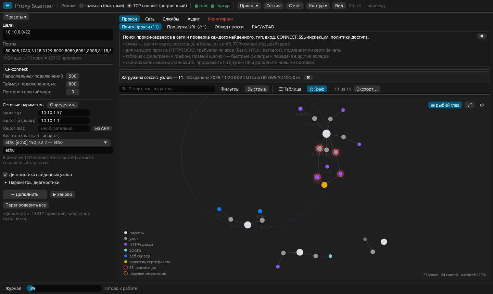

### Проверка URL

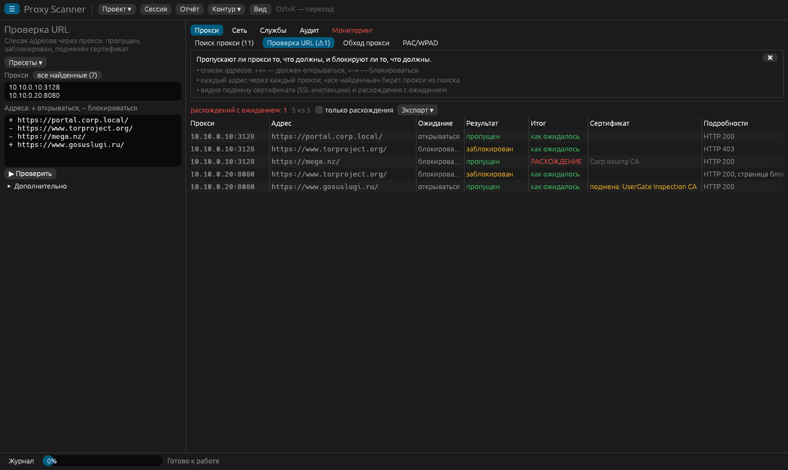

Список адресов с ожиданием: `+` — должен открываться, `-` — должен блокироваться. Каждый адрес
проверяется через каждый прокси (кнопка «все найденные» подставляет прокси из поиска).
Результат — пропущен / заблокирован / подменён сертификат и **расхождения с ожиданием**.
Подходит для проверки политик после изменений на прокси.

### Обход прокси

Можно ли с рабочей станции выйти наружу мимо прокси: прямые TCP-подключения на набор портов
(до portquiz.net или своего слушателя), внешние DNS-серверы, HTTP и HTTPS с распознаванием
прозрачного прокси. В закрытом контуре на машине за периметром запускается встроенный
слушатель — он подтверждает, что соединение дошло именно до него.

### PAC/WPAD

Настройки прокси в системе (реестр, групповые политики, WinHTTP; в Linux — переменные
окружения и GNOME), поиск WPAD по DNS-суффиксам, загрузка PAC-файла по URL или из файла и
вычисление `FindProxyForURL` для списка адресов (встроенный JavaScript-движок). Прокси из
ответов PAC одной кнопкой добавляются в поиск.

---

## Сеть

### Хост

Вся сетевая конфигурация этой машины на одной странице — как `ipconfig /all`, `route print`,
`arp -a` и `netstat -anob` вместе: интерфейсы (адреса, шлюз, DNS, DHCP-сервер, суффикс, MTU,
скорость, производитель сетевой карты), таблица маршрутов, ARP-таблица, соединения с
привязкой к процессам и фильтром «только прослушиваемые порты».

### MTR

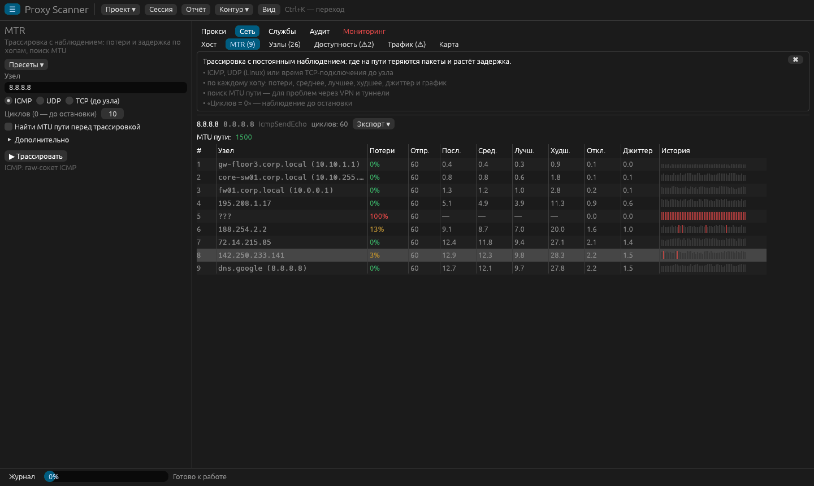

Трассировка с постоянным наблюдением: по каждому хопу — потери, последнее, среднее, лучшее и
худшее время, отклонение, джиттер и график. Несколько адресов на одном хопе — признак
балансировки.

| Режим | Windows | Linux |
|---|---|---|
| ICMP | без прав администратора | root или разрешённый ping-сокет |
| UDP (порты 33434+) | — | без прав |
| TCP (время подключения до узла) | да | да |

**Поиск MTU пути** — пробы с запретом фрагментации (1500, 9000, затем двоичный поиск).
Находит «чёрные дыры» PMTU — частую причину зависаний через VPN.

### Узлы

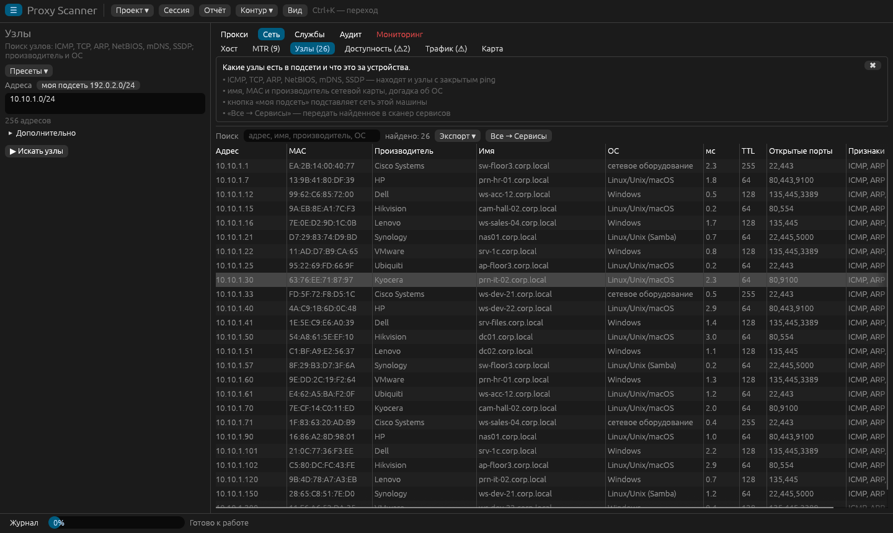

Какие узлы есть в подсети (до /16) и что это за устройства: ICMP, TCP по набору портов (ответ
RST тоже признак жизни — так находятся узлы с закрытым ping), ARP, NetBIOS (имя, домен,
контроллеры, файловые серверы), mDNS, SSDP/UPnP, обратный DNS. Для каждого узла — MAC и
производитель (база IEEE OUI, около 40 000 записей, работает без интернета) и догадка об ОС.

### Доступность

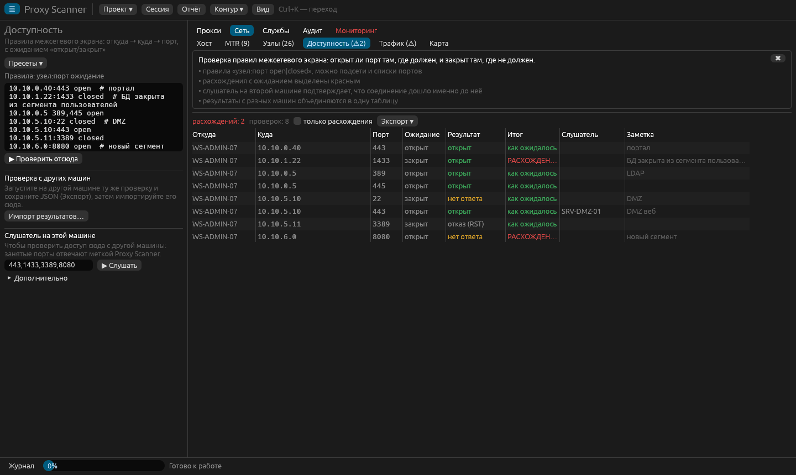

Проверка правил межсетевого экрана. Правила по одному в строке:

```text
10.0.0.5:443 open          # портал
10.0.0.20:1433 closed      # БД закрыта из этого сегмента
10.0.1.0/29 22,3389 closed
```

Результат — открыт / отказ (RST) / нет ответа и «как ожидалось» или **расхождение**. Чтобы
проверить доступ к машине, где порт ещё никто не слушает, на ней запускается встроенный
слушатель (кнопка «Слушать» или `proxy-scanner-cli listen 443,1433`). Результаты с других
машин импортируются и показываются в одной таблице с колонкой «Откуда».

### Трафик

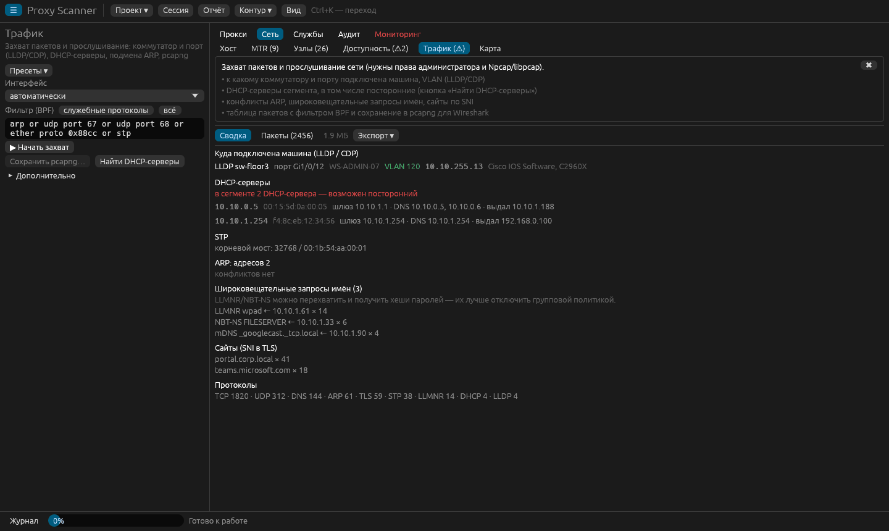

Захват пакетов и прослушивание (нужны права администратора и Npcap/libpcap — тот же драйвер,
что для masscan).

* **К какому коммутатору и порту** подключена машина и в каком VLAN — по LLDP и CDP.
* **DHCP-серверы** сегмента; кнопка «Найти DHCP-серверы» рассылает DHCP DISCOVER — ответят
  все, в том числе посторонние.
* Корень STP, **конфликты ARP** (признак подмены), широковещательные запросы имён
  LLMNR/NBT-NS/mDNS (их перехватывают для кражи хешей — лучше отключить), сайты по SNI в TLS.
* Таблица пакетов с разбором основных протоколов, фильтр BPF как в tcpdump/Wireshark,
  **сохранение в pcapng** для подробного разбора в Wireshark.

### Карта

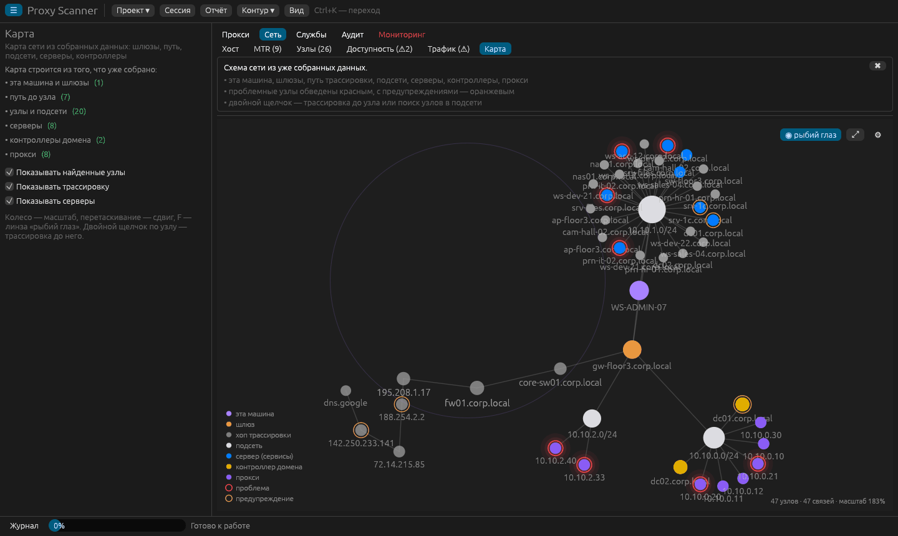

Схема сети из уже собранных данных: эта машина и шлюзы, путь трассировки, подсети и узлы,
серверы, контроллеры домена, прокси. Проблемные узлы обведены красным, с предупреждениями —
оранжевым. Двойной щелчок по узлу — трассировка до него, по подсети — поиск узлов в ней.

---

## Службы

### DNS

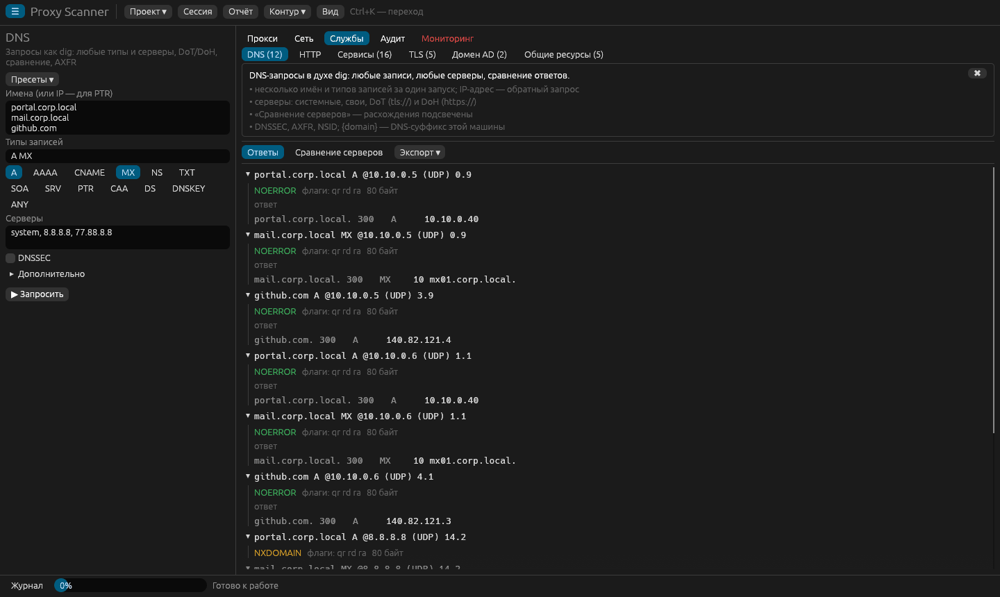

Запросы в духе `dig`: любые типы записей (A, AAAA, CNAME, MX, NS, TXT, SOA, SRV, PTR, CAA,
DNSKEY, DS, TLSA, HTTPS…), несколько имён и серверов сразу.

* Серверы: `system` (из настроек системы), свои адреса, `tls://…` (DoT), `https://…` (DoH).
* **Сравнение серверов**: таблица запрос × сервер, расхождения подсвечены (split-horizon,
  подмена ответов, несинхронизированные зоны).
* DNSSEC (флаг AD), NSID, AXFR, автоматический переход на TCP при обрезанном ответе.
* `{domain}` в имени заменяется DNS-суффиксом машины — пресет «AD: SRV-записи домена» находит
  контроллеры без ввода имени домена.

### HTTP

Один запрос со всеми подробностями, как `curl -v`: время по фазам (DNS, TCP, CONNECT через
прокси, TLS, ожидание первого байта, загрузка), сырые заголовки, тело, цепочка
перенаправлений, цепочка сертификатов и доверие к ней. Напрямую или через прокси с входом
NTLM/Kerberos (в Windows — под текущим пользователем). Подмена адреса как `curl --resolve`,
повторы для оценки разброса времени ответа.

### Сервисы

Какие сервисы и каких версий работают на узлах:

* **TCP**: SSH, FTP, SMTP, POP3, IMAP, Telnet, VNC, MySQL/MariaDB, HTTP (Server, заголовок
  страницы, требование входа), TLS на любом порту, SMB (диалект, SMBv1, подпись), RDP (NLA или
  нет), MSSQL (версия и год), PostgreSQL, Redis, memcached, Elasticsearch.
* **UDP**: DNS, NTP (**сдвиг часов** — больше 5 минут ломает вход в домен), SNMP, NetBIOS,
  MSSQL Browser, SSDP, mDNS.

### TLS

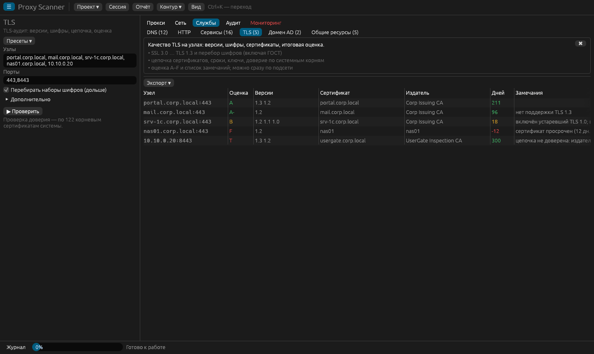

Аудит в духе testssl по одному узлу или по всей сети: поддержка SSL 3.0 … TLS 1.3 (собственный
ClientHello — видны и версии, которых нет в современных библиотеках), перебор шифров с оценкой
(небезопасный / слабый / допустимый / сильный, включая ГОСТ), цепочка сертификатов (ключ,
подпись, сроки, имена) с проверкой по системным корням и итоговая оценка **A, A-, B, F или T**
со списком замечаний.

### Домен AD

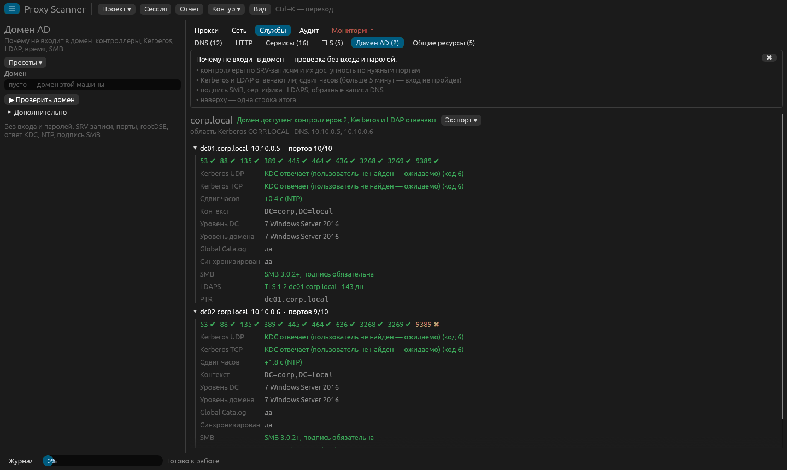

Ответ на вопрос «почему не входит в домен» — без входа и паролей: SRV-записи контроллеров,
Kerberos и Global Catalog; доступность контроллеров по нужным портам; rootDSE по LDAP;
**Kerberos** (запрос для несуществующего пользователя: KDC отвечает — значит работает, а время в
ответе даёт сдвиг часов); **сдвиг часов** по NTP, Kerberos или LDAP; подпись SMB; сертификат
LDAPS. Наверху — одна строка итога.

### Общие ресурсы

SMB-шары и NFS-экспорты на узлах. SMB — анонимно, под учётной записью (NTLMv2 с подписью) или,
в Windows, под текущим пользователем; для каждой шары — удалось ли подключиться. Содержимое не
читается. Шары, доступные без пароля, и NFS-экспорты «для всех» попадают в находки отчёта.

---

## Аудит

### Аудит настроек

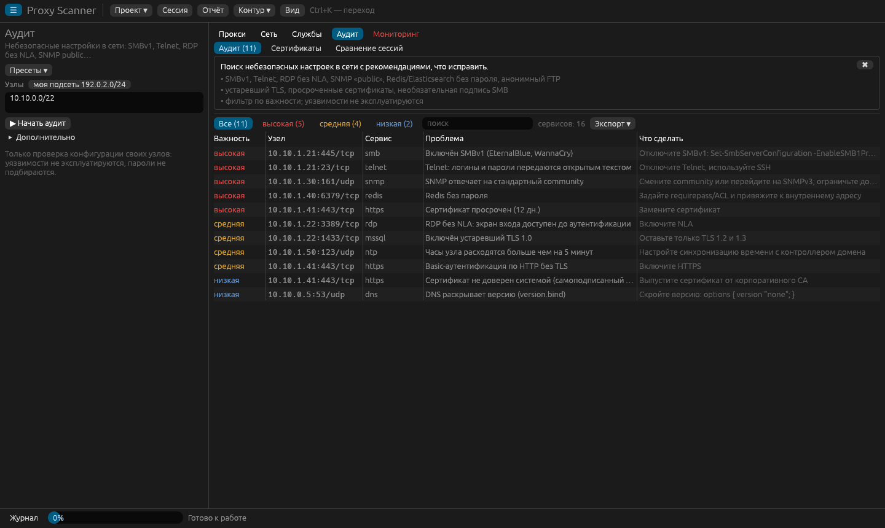

Поиск небезопасных настроек в своей сети с рекомендациями, что сделать:

| Важность | Примеры |
|---|---|
| высокая | SMBv1, Telnet, RDP без NLA, SNMP с `public`, Redis/Elasticsearch/Docker API без пароля, анонимный FTP, VNC без пароля, SSL 3.0, просроченный сертификат |
| средняя | необязательная подпись SMB, TLS 1.0/1.1, FTP без шифрования, Basic по HTTP, устаревший OpenSSH, истекающий сертификат, расхождение часов |
| низкая | недоверенный сертификат, раскрытие версии DNS, SQL Browser |

Уязвимости не эксплуатируются, пароли не подбираются.

### Сертификаты

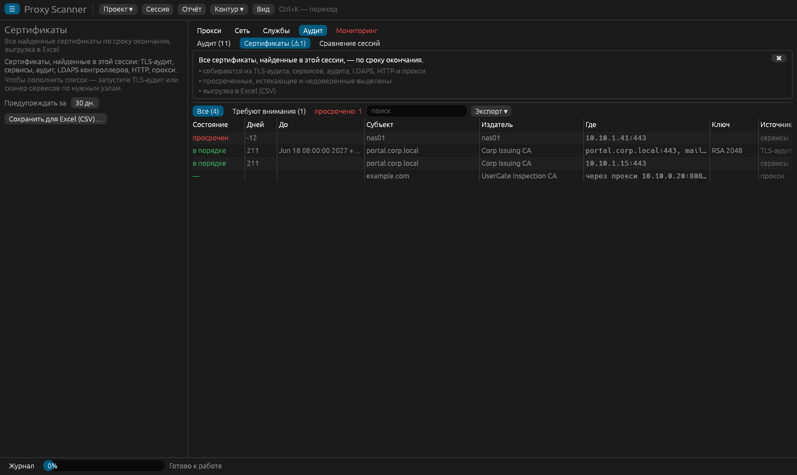

Все сертификаты, найденные в сессии (TLS-аудит, сервисы, аудит, LDAPS контроллеров, HTTP,
прокси), в одной таблице по сроку окончания: просроченные, истекающие, недоверенные.
Выгрузка в Excel (CSV).

### Сравнение сессий

Что изменилось между двумя проверками: узлы, сервисы и версии, прокси, сертификаты, TLS,
DNS-ответы, находки, доступность. «Было» — файл или копия из архива, «Стало» — текущая сессия.

---

## Диагностика

### Почему не открывается

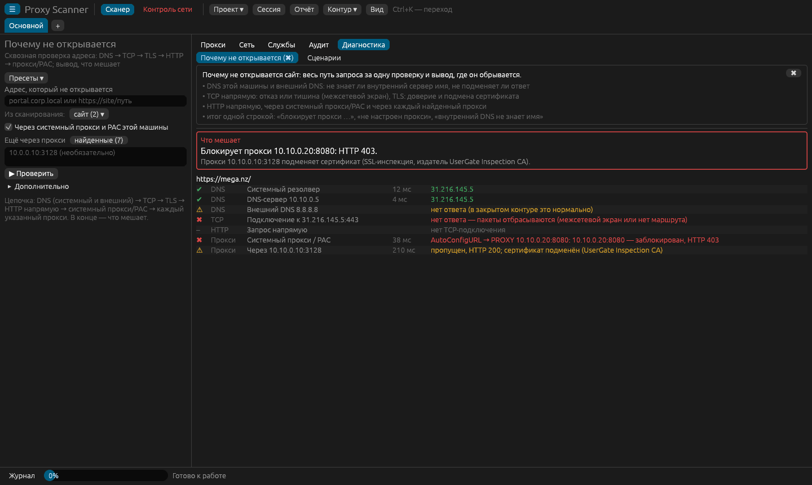

Одна проверка проходит весь путь запроса и пишет, где он обрывается:

* **DNS** этой машины и внешний DNS: не знает ли внутренний сервер имя, не подменяет ли ответ;
* **TCP** напрямую: отказ (RST) или тишина (межсетевой экран, нет маршрута);
* **TLS**: доверие к сертификату и подмена (SSL-инспекция);
* **HTTP** напрямую, через **системный прокси / PAC** этой машины и через каждый найденный прокси.

Итог — одной-двумя строками: «Блокирует прокси 10.0.0.20:8080: HTTP 403», «Напрямую закрыто,
а через прокси открывается — у пользователя не настроен прокси», «Внутренний DNS не знает имя».

### Сценарии

Несколько проверок подряд одной кнопкой; найденное одним шагом передаётся следующему, результаты
раскладываются по вкладкам и попадают в отчёт. Готовые: «Приёмка нового сегмента» (узлы →
сервисы → аудит → TLS → общие ресурсы), «Почему не работает домен», «Быстрый аудит подсети».
Свои — JSON с шагами, пресетами и подстановками `{subnet}`, `{hosts}`, `{tls_hosts}`,
`{smb_hosts}`. Из командной строки: `playbook файл.json -o отчёт.html`.

**По расписанию** (каждый день, раз в неделю или каждые N часов — задание Планировщика Windows
от имени SYSTEM или таймер systemd): прогон сохраняется в историю, сравнивается с прошлым, и на
почту уходит HTML-отчёт с блоком «Что изменилось с прошлого прогона».

### Карточка узла

Правый щелчок по любому адресу → «Карточка узла»: имена, MAC и производитель, коммутатор,
порт и VLAN, открытые порты и версии, известные уязвимости, находки аудита и TLS, сертификаты,
мониторинг, история изменений из наблюдения, с кем общается по трафику. Свои **метки и
заметка** («сервер 1С, ответственный Иванов») сохраняются в сессии и видны в «Адресах».

### Известные уязвимости

Версии из баннеров (OpenSSH, Apache, nginx, OpenSSL, vsftpd, ProFTPD, Exim, Samba, IIS, PHP,
Tomcat) сверяются со встроенной базой: regreSSHion, Terrapin, Heartbleed, Ghostcat, SambaCry,
обход каталогов Apache 2.4.49/50 и другие. Отметки — в «Сервисах», находки — в «Аудите» и в
карточке узла. Совпадение — повод проверить: дистрибутивы переносят исправления без смены версии.

---

## Контроль сети

### Обзор

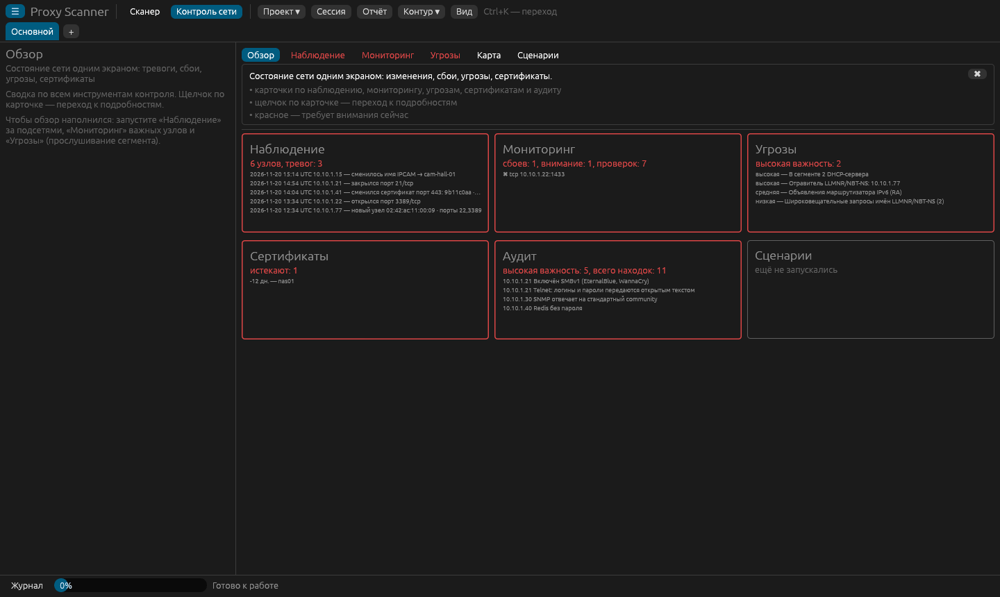

Карточки по наблюдению, мониторингу, угрозам, сертификатам, аудиту и сценариям; красное —
требует внимания. Щелчок по карточке — переход к подробностям.

### Наблюдение

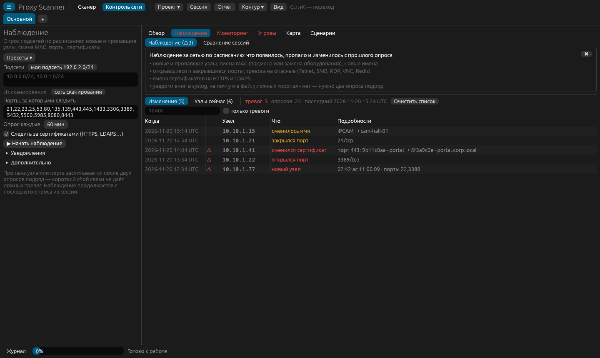

Подсети опрашиваются по расписанию, каждый опрос сравнивается с прошлым:

* новые и пропавшие узлы, смена MAC (подмена или замена оборудования), смена имени;
* открывшиеся и закрывшиеся порты — тревога на опасные (Telnet, SMB, RDP, VNC, Redis);
* смена сертификатов на HTTPS и LDAPS;
* уведомления в syslog, на почту и в файл.

Пропажа засчитывается после двух опросов подряд — короткий сбой связи не даёт ложных тревог.

### Мониторинг

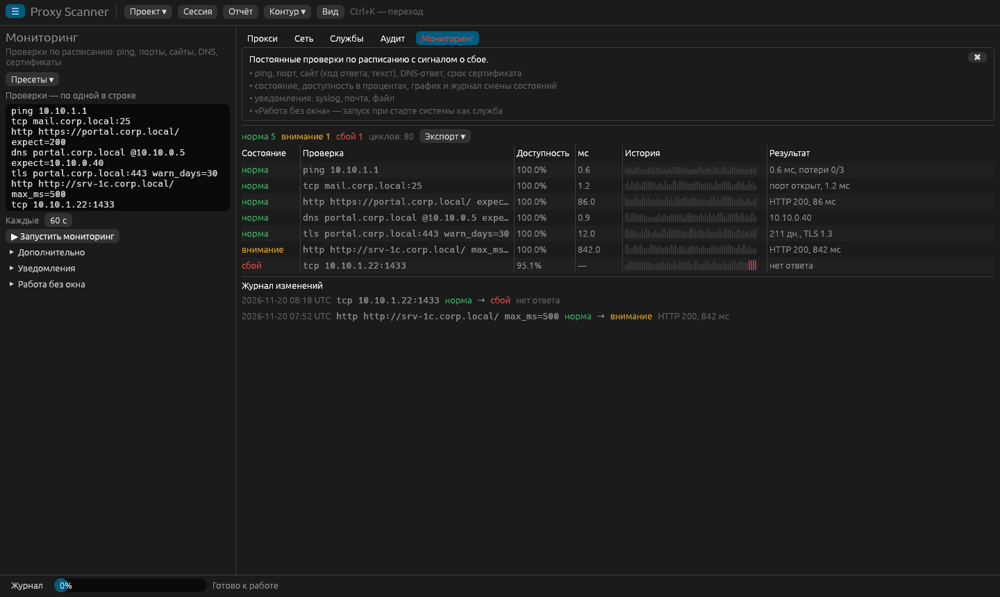

Проверки по одной в строке, выполняются каждые N секунд:

```text
ping 10.0.0.1
tcp  mail.corp.local:25
http https://portal.corp.local/ expect=200 max_ms=1500 contains=Вход
dns  portal.corp.local @10.0.0.53 expect=10.0.0.5
tls  portal.corp.local:443 warn_days=30
```

* Состояние (норма / внимание / сбой), доступность в процентах, график, журнал смены состояний;
  при сбое программа мигает на панели задач.
* **Уведомления**: syslog, почта через внутренний SMTP-релей, файл журнала.
* **Работа без окна**: проверки запускаются при старте системы — в Windows заданием
  Планировщика от имени SYSTEM, в Linux службой systemd.

### Адреса

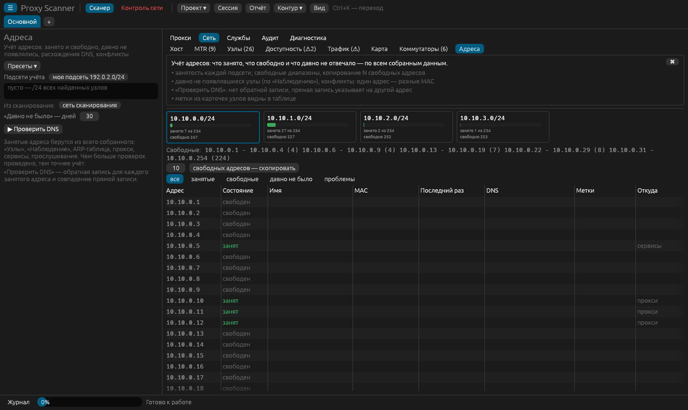

Занятые адреса собираются из всего, что известно: «Узлы», «Наблюдение», ARP-таблица, прокси,
сервисы, прослушивание. Для каждой подсети — занятость, свободные диапазоны и кнопка
«скопировать N свободных»; фильтры «давно не было» (по наблюдению), «проблемы»: конфликт
(один адрес — разные MAC), нет обратной записи DNS, прямая запись указывает на другой адрес.

### Угрозы

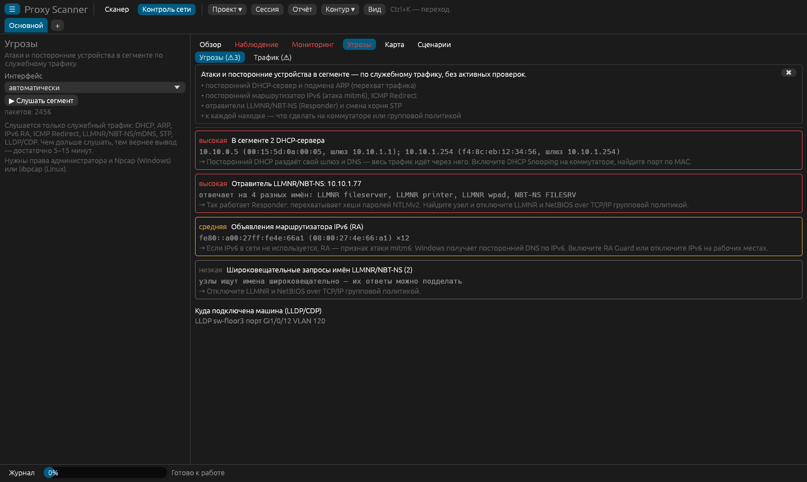

Прослушивание служебного трафика без активных проверок: посторонний DHCP-сервер, подмена ARP,
посторонний маршрутизатор IPv6 (атака mitm6), ICMP Redirect, отравители LLMNR/NBT-NS
(Responder), смена корня STP. К каждой находке — что сделать на коммутаторе или групповой
политикой.

### Живая карта и коммутаторы

Карта обновляется сама: связи по объёму трафика с бегущими точками, красные — к узлам со
сбоем мониторинга, оранжевые кольца — изменения из наблюдения. После опроса коммутаторов по
SNMP узлы привязываются к портам, а в меню любого узла работает **«Где воткнут?»**:
коммутатор, порт и VLAN.

---

## Общие возможности

### Отчёт

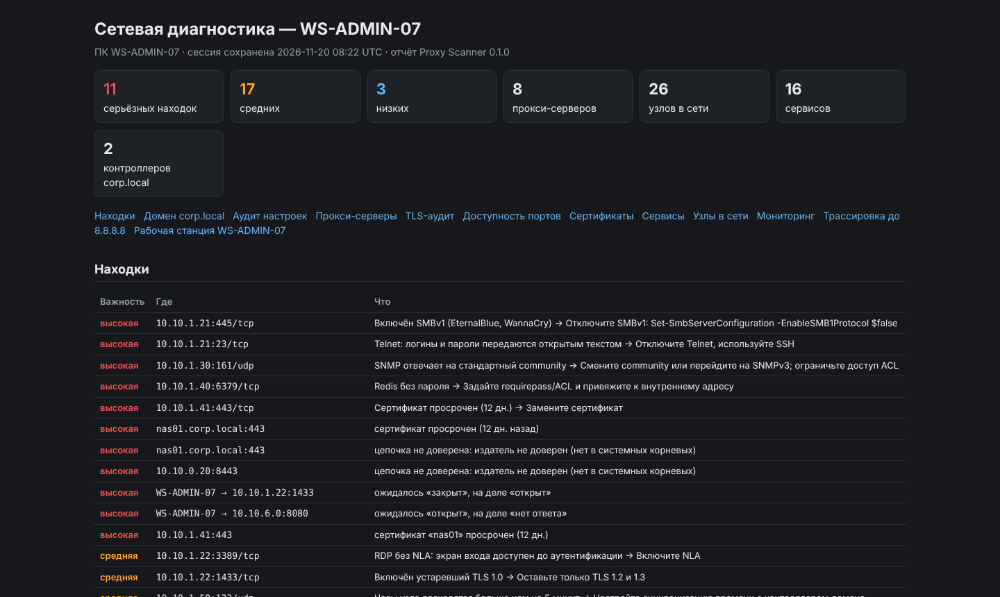

Кнопка **«Отчёт»** сохраняет один HTML-файл по всей сессии: итоги, общий список находок всех
разделов по важности и подробные таблицы. Файл без внешних ссылок, открывается в любом
браузере, печатается, поддерживает светлую и тёмную тему.

### Данные сканирования во всех разделах

Найденное на вкладке «Прокси» подставляется в остальные инструменты одной кнопкой: под полем
адресов — строка **«Из сканирования:»**. Например, «Аудит» только по найденным узлам,
«TLS» по узлам с HTTPS, «Мониторинг» — проверки портов всех найденных прокси, «Доступность» —
каждый открытый порт как правило для проверки с другой машины.

### Проекты и сессии

* **Проекты** — вкладки под шапкой, как в браузере: у каждого объекта или филиала свои цели,
  настройки инструментов, результаты и архив; «+» открывает или создаёт проект.
* **Сессия** сохраняется автоматически рядом с программой (при закрытии, остановке и во время
  работы). Её можно перенести на другой ПК вместе с программой — в том числе между Windows и
  Linux. Перед новым сканированием прежние результаты копируются в архив (последние 30 копий).
* Пароли в файлы не записываются.

### Пресеты, открытый и закрытый контур

* У каждого инструмента — кнопка **«Пресеты ▾»**: встроенные наборы («Windows и AD», «Только
  сертификаты», «Поиск MTU (VPN)»…) и свои — с сохранением, импортом и экспортом.
* Меню **«Контур ▾»** переключает все инструменты сразу:
  **открытый контур** — публичные тестовые узлы и DNS для сравнения;
  **закрытый контур** — никаких обращений к внешним узлам, только системные DNS.

### Удобство

* **Ctrl+K** — переход к инструменту, пресету или найденному узлу; там же калькулятор подсетей:
  `10.0.1.5/22` (сеть, маска, узлы), `10.0.0.0/22 /24` (разбить), `10.0.1.5 в 10.0.0.0/22`,
  диапазон `a-b` или несколько сетей (суммаризация).
* Правый щелчок по узлу — **«Разбудить (Wake-on-LAN)»** и **«Где воткнут?»** (MAC берётся из
  «Узлов», «Наблюдения» или ARP-таблицы).
* Правый щелчок по узлу в любой таблице — передать его в MTR, DNS, HTTP, сервисы, TLS,
  доступность, мониторинг или поиск прокси.
* Адаптивный интерфейс: на узком окне панели превращаются во вкладки; масштаб и тема — в меню
  «Вид».

---

## Командная строка

Те же инструменты без окна — для скриптов, планировщика и удалённых сессий. В Windows —
`proxy-scanner-cli.exe`, в Linux — `proxy-scanner-cli` или `proxy-scanner <команда>`.
Вывод текстом или в JSON (`--json`), запись в файл (`-o`), пресеты (`--preset`), любые
параметры (`--set поле=значение`, список полей — `<команда> --fields`).

| Команда | Что делает |
|---|---|
| `host` | состояние машины |
| `mtr УЗЕЛ` / `ping УЗЕЛ` | трассировка / ping |
| `discover ПОДСЕТЬ` | обнаружение узлов |
| `dns ИМЯ [ТИП…] [@СЕРВЕР…]` | DNS-запросы, как dig |
| `http URL` | HTTP-запрос с таймингами |
| `services УЗЛЫ [-p ПОРТЫ]` | сервисы и версии |
| `tls УЗЛЫ [-p ПОРТЫ]` | TLS-аудит |
| `ad [ДОМЕН]` | проверка домена AD |
| `audit УЗЛЫ` | аудит настроек |
| `shares УЗЛЫ` | SMB-шары и NFS-экспорты |
| `matrix ПРАВИЛА.txt` / `listen ПОРТЫ` | доступность / слушатель |
| `urls СПИСОК.txt --set proxies=…` | проверка адресов через прокси |
| `proxy ЦЕЛИ [-p ПОРТЫ]` | поиск и диагностика прокси |
| `capture [-o файл.pcapng]` | захват пакетов или сводка прослушивания |
| `monitor ФАЙЛ` / `service install\|status\|uninstall` | мониторинг / мониторинг без окна |
| `certs СЕССИЯ.json` / `compare БЫЛО.json СТАЛО.json` / `report СЕССИЯ.json` | сертификаты / сравнение / HTML-отчёт |
| `site АДРЕС` | почему не открывается сайт |
| `watch ПОДСЕТИ` | наблюдение за изменениями (Ctrl+C — стоп) |
| `threats [--set seconds=300]` | угрозы в сегменте по прослушиванию |
| `snmp КОММУТАТОРЫ [locate MAC]` | таблицы коммутаторов / где воткнут |
| `playbook ФАЙЛ.json\|ИМЯ [-o отчёт.html]` / `playbook list` | сценарии |
| `calc 10.0.0.0/22 /24` / `wol MAC` | калькулятор подсетей / Wake-on-LAN |
| `scheduled [--config файл]` | прогон по расписанию: история, сравнение, отчёт на почту |
| `presets [инструмент]` | список пресетов |

```bash
proxy-scanner-cli dns portal.corp.local MX @10.0.0.53 @tls://1.1.1.1
```

```bash
proxy-scanner-cli tls 10.0.0.0/24 -p 443,8443 --preset "Только сертификаты" --json -o tls.json
```

```bash
proxy-scanner-cli audit 10.0.0.0/24 --preset "Быстро: Windows-сеть"
```

```bash
proxy-scanner-cli proxy 10.0.0.0/16 --preset "Порты: все популярные" -o proxies.csv
```

В PowerShell сервер DNS берите в кавычки: `dns example.com '@10.0.0.53'`. Пароли — в
переменных окружения `PROXY_SCANNER_PROXY_PASSWORD` (прокси) и `PROXY_SCANNER_PASSWORD` (шары).

---

## Сборка

Rust (edition 2024), `egui`/`eframe`, `tokio`, `rustls`. Сборка — в GitHub Actions
([`.github/workflows/build.yml`](.github/workflows/build.yml)) при каждом `push`:

```bash
cargo build --release --target x86_64-pc-windows-msvc
```

CRT в Windows линкуется статически, поэтому `proxy-scanner.exe` — один автономный файл без
VC++ Redistributable. Для Linux программа собирается на Ubuntu 22.04. В CI выполняются тесты
(около 150), проверки командной строки на Windows и Linux и сборка masscan из официальных
исходников. Подробности по запуску и скорости — в папке [`docs`](docs).

## Ответственное использование

Программа предназначена для администраторов собственной инфраструктуры. Сканируйте и
проверяйте только те сети и узлы, на проверку которых у вас есть полномочия. Аудит только
проверяет настройки: уязвимости не эксплуатируются, пароли не подбираются, содержимое общих
ресурсов не читается.
